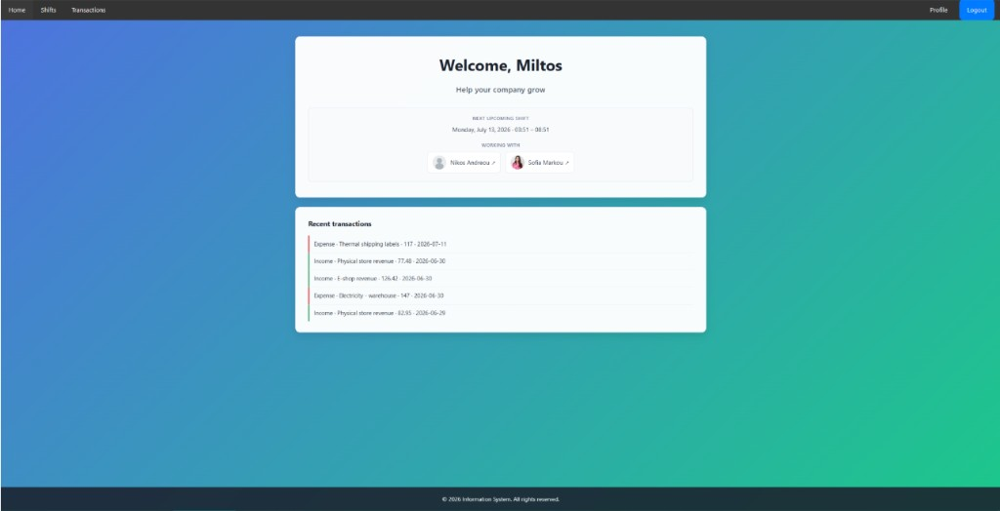

# Company information system

Small information system as website for companies, covering core features such as staff management, shift scheduling + email notification, income and expense tracking, and financial forecasting.

---

---

## Tools

**Languages & setup:** , , , , , , , , , 

**Libraries:**  , , , , , , , , , 

---

---

## Build & run

First start: MySQL loads `init.sql`, Composer installs PHP packages in the container, Eleventy builds HTML (shared navbar/footer) into `_site/`.

There are **seed accounts** whose credentials and roles are explained further down.
Fill SMTP in `.env` ++only++ to enable email features (verify account, shift notifications, password/username/email reset, company request). For full use of core features email verification is not needed. `env.example` contains default values that allow the project to build and run, excluding email features.

### Quick Start

```bash
cp .env.example .env
docker compose up --build
```

### Envioroment variables set up


| Variable                                           | Local default                  |
| -------------------------------------------------- | ------------------------------ |
| `WEB_PORT`                                         | `8080`                         |
| `APP_BASE_URL`                                     | `http://localhost:8080`        |
| `DB_SERVER_NAME`                                   | `db`                           |
| `DB_NAME` / `DB_USERNAME` / `DB_PASS`              | `ps_db` / `root` / `root`      |
| `EMAIL_HOST` / `EMAIL_PORT`                        | `smtp.gmail.com` / `587`       |
| `EMAIL_USER` / `EMAIL_APP_PASS` / `MAIL_FROM_NAME` | only needed for email features |


### Quick Gmail set up

Gmail SMTP : enable 2-step verification, create an [App password](https://myaccount.google.com/apppasswords), placed in `EMAIL_APP_PASS` variable.

`MAIL_FROM_NAME` : Name of the website / sender.
`EMAIL_USER` : address of email.

---

### Seed logins

Company **CompanyX**. Password for every seed user: `1234` (seed-only; signup/reset require ≥8 chars, letter + digit). Seed emails are already verified but not real addresses. Historic data covers **2023–2026**.


| Username     | Name               | Type     | Privileges                      | Profile photo       |
| ------------ | ------------------ | -------- | ------------------------------- | ------------------- |
| `chrisvlas1` | Christos Vlassis   | Manager  | all (manager bypass)            | none                |
| `miltos90`   | Miltos Karabasilis | Employee | income, expenses                | `1_seed_miltos.png` |
| `anna6`      | Anna Dimitriou     | Employee | none                            | `2_seed_anna.png`   |
| `nikos21`    | Nikos Andreou      | Employee | none                            | none                |
| `sofia111`   | Sofia Markou       | Employee | none                            | none                |
| `petros89`   | Petros Ioannou     | Employee | income, expenses, money-tracker | none                |


Signup into the same company:


| Who      | Company code     |
| -------- | ---------------- |
| Manager  | `09ir13AhOekoII` |
| Employee | `10ir1oL9Oe2oII` |


New employees start with **no** privilege flags until a manager (or someone with the manage-employees flag) grants them.  They can only see the shifts table and colleagues' profiles.

**Open** **[Login Page** ++at++ http://localhost:8080/html/auth/login.html](http://localhost:8080/html/auth/login.html) (default web port 8080).

---

### Privileges

The manager always has full access. Employees only see/use what their flags allow.


| Flag               | Unlocks                                                                              |
| ------------------ | ------------------------------------------------------------------------------------ |
| `income`           | Income list, create, attachments + notes, delete/retrieve,                           |
| `expenses`         | Same                                                                                 |
| `money-tracker`    | Yearly graphs (income / expense / net); 3 forecast models; download graph + forecast |
| `shift`            | Add/delete weekly and one-off shifts; manage others’ shift calendars                 |
| `manage-employees` | grant/revoke the flags above, append notes                                           |


---

---

## Core functionality

- **Auth & companies:**
  - **Companies:** request a new company --> activation through email after communicating needs with Informational System team --> Company recives manager and employee signup codes.
  - **Users:** signup with a company code.
- **Privileges:** manager has full access. Employees get flags (income, expenses, money-tracker, shifts, manage-employees).UX and API check these.
- **Profiles:**
  - **Full name** and **email**.
  - **Profile photo**
  - **Role**
  - **Description (self edited)**
  - **Notes (Users with** `manage-employees` **flag can edit this)**
- **Shifts:** weekly + one-off on a calendar, creating or deleting sends a notification on email. Max 12 hours per shift; checkout after check-in; no past one-off dates. Home page shows the next shift and coworkers on that slot. UX and API check these.
- **Transactions:** income/expense lists, search, create transactions with optional fields; attachment, Note. 
- **Money tracker:**
  - **Graphs:** yearly graph (each bar is a month) for  Income, and Expense and NetIncome.
  - **Forecasts:** remaining months of this year, or a future year. Three models: Growth Rate [Same-month average, then one growth %.], Driver-Based ( Same-month average, then one growth % per source), Extreme Gradient Boosting [XGBoost].
  - **Download:** graph (PNG) + info || forecast (ZIP with graph + info).

---

---

## Business logic

- **Data is company-scoped**. Each user belongs to one company.
- **Soft-delete on transactions**. Also **Transactions notes** appends lines `Created` / `Deleted` / `Retrieved` with name, id, timestamp. Delete is only **soft**; after **6 months** the transaction is **auto-deleted** on the next related request. Until then, retrieve restores the row and appends `Retrieved`.
- **Employee notes — append only:** each new note is `(timestamp) Name Surname (id): (note)`. History is not rewritten; caps are 1000 chars per note / 10000 total.
- **Forecasts (all three models):**
  - Remaining months of this year, or a full future year. 
  - A complete forecast is used to generate a new forecast, needs **same** model (Growth↔Growth, Driver↔Driver, XGBoost↔XGBoost).
  - Session-only (lost on leave/refresh). Users are notified of this limitation when attempting to perform the action.
  - Growth Rate / Driver-Based: year-over-year on the **same month**. XGBoost: also depends on **recent months** (lags).
  - **Download:**
    - Historic: PNG `{Plot}_Historic_Data_{Year}_total_value_Is_{roundedTotal}.png` (e.g. `Income_Historic_Data_2025_total_value_Is_120000.png`)
    - Forecast: ZIP `{Plot}_{Model}_{Year}.zip` (`Plot` = NetIncome | Income | Expense, `Model` = Growth_Rate | Driver_based | Gradient_Boosting). No overlays:

```
Income_Growth_Rate_2027.zip
├── Income_Growth_Rate_2027.png
└── Income_Growth_Rate_2027.txt
```

`.txt` = model, year, total, examined years, rates, list of training overlays. Same forecast is not packed twice.

With training overlays, each overlay is its own folder (png + txt inside; nested again if that overlay had overlays):

```
NetIncome_Gradient_Boosting_2027.zip
├── NetIncome_Gradient_Boosting_2027.png
├── NetIncome_Gradient_Boosting_2027.txt
└── training_forecasts/
    └── forecast_2_NetIncome_Gradient_Boosting_2026/
        ├── NetIncome_Gradient_Boosting_2026.png
        ├── NetIncome_Gradient_Boosting_2026.txt
        └── training_forecasts/
            └── ...
```

---

---

## UI / UX

The UI follows the style shown in the reference image below.



### Interface details (selected)

- **Navigation:** the navbar shows only links the current user can use.. 
- **Same-page modals:** some examples of these are forecast setup, displaying transaction notes, delete account confirmation.
- **Calendar:** month navigation. Each displayed name is a link that redirects to profile.
- **Search & UI Readability:**
  - Real-time Search: Search triggers instantly **per-character input**.
  - User ID Visibility: User IDs are displayed alongside user names across the UI to improve readability.
- **Feedback:**
  - **Global Action Spinner:** Displays feedback during ongoing requests.
  - **Alert Notifications:** Prompts users regarding critical actions and warnings.
  Ex.:
    - **On Forecast Page:** Warns users before leaving that page-specific where data is session-only.
    - **Delete Account:** Triggers a warning/confirmation dialog.

---

---

## Security

- **Sessions:** login required (`check_session`).
  - `session.cookie_httponly`**:** JavaScript cannot read the session cookie (limits theft via XSS).
  - `session.use_only_cookies`**:** the session id is accepted only with cookie, not in the URL (limits session fixation / leakage).
  - `session_regenerate_id(true)`**:** a new session id is issued at login, so a pre-login id cannot be reused.
  - `session.cookie_samesite = Lax`**:** the cookie is not sent on cross-site POST/embed (CSRF mitigation).
  - `session.cookie_secure`**:** cookie is marked Secure on HTTPS so it is not sent over plain HTTP.
- **Transactions:** `$conn->begin_transaction()` so related write operations are executed as a single atomic unit.
- **Logout:** session is cleared and the cookie sets as expired.
- **Passwords:** stored with `password_hash`. Signup/reset require **≥8 characters**, at least **one letter and one digit**. Seed `1234` is database-only.
- **SQL:** queries use **prepared statements** (`bind_param`).
- **Access control:** data requests are **company-scoped**. 
- **Auth abuse:** login/signup (and related recovery) are **rate-limited** (5 failures / 15 minutes, then a 15-minute cooldown), keyed by IP + identifier.
- **Uploads:** type and size are validated; stored names are **randomized** and sanitized; downloads require a matching **company + privilege** row (no arbitrary path).
- **Email tokens:** verification and reset tokens are random (`random_bytes`), stored hashed-use in DB, and expire in **24 hours**.
- **Errors:** users see generic messages. Server errors go to `logs/appErrorLog.json` (append-only JSON via `logAppError`). PHP runtime errors go to `logs/php_errors.log`. The browser reports uncaught errors and unhandled promise rejections to `logClientError.php` (tagged `client`). Database-down is a generic 503 (“Try again later.”) so internals are not shown to the user.

---

---

## Forecast models

The Growth Rate and Driver-Based approaches are primarily designed to capture year-over-year changes for the same month. In contrast, Extreme Gradient Boosting is more suitable for scenarios where monthly values depend on recent months, rather than solely on the corresponding month of the previous year.

### Extreme Gradient Boost (XGBoost)

PHP (`forecastGradientBoost.php`) loads the company’s income/expenses and runs `src/python/gradient_boost/forecast.py`.

- Creates additional features: lags 1–3, rolling means, same month in earlier years, historical mean, per-**source** lags, insufficient-history flag.
- **XGBoost** regressor, **Optuna** (~20 trials) to pick hyperparameters, K-fold MAE, a simple overfit check.
- Trains on past years (and/or completed months of the current year). Needs at least **5** month of data. Predictions are clipped at 0.
- Current year: keeps actuals through the last included month, then forecasts the rest.
- Separate income and expense models; net = income − expense.

### Growth Rate

Custom monthly average with one income % and one expense %. For each calendar month: sum examined years, apply `(1 + % / 100)`, then divide by years that had a non-zero value that month (empty months are skipped). Net uses the two series.

### Driver-Based

Same averaging, but **per source**. Each income/expense source has its own %. Default is 0.

---

---

More information on requirements exists in `/requirmetns`. Explicit pages:

- [Requirements](requirmetns/1-requirements.md) (Functional & Non-Functional)
- [Security requirements](requirmetns/2-security-requirements.md)
- [Database structure](requirmetns/3-database-structure.md)

