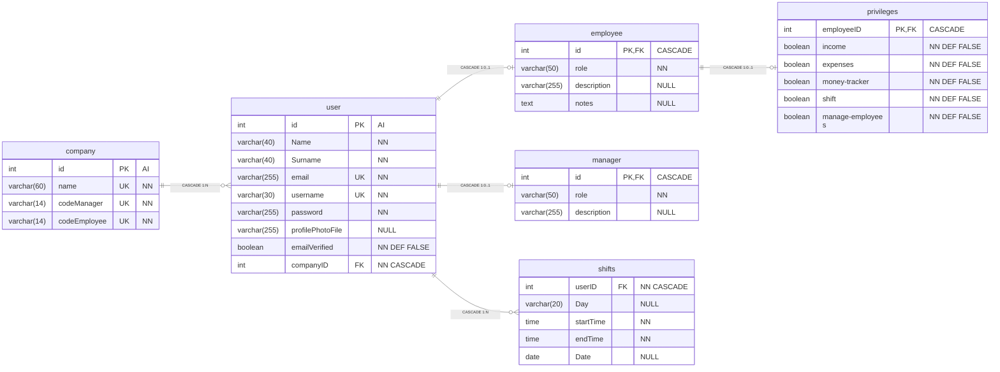
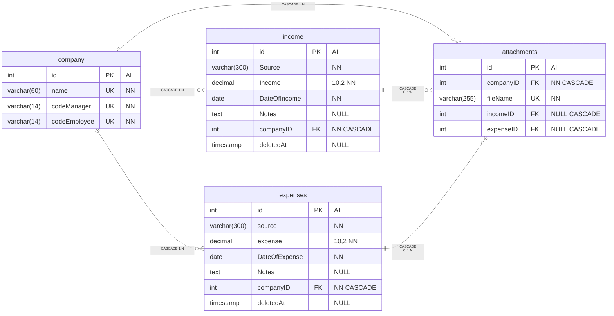
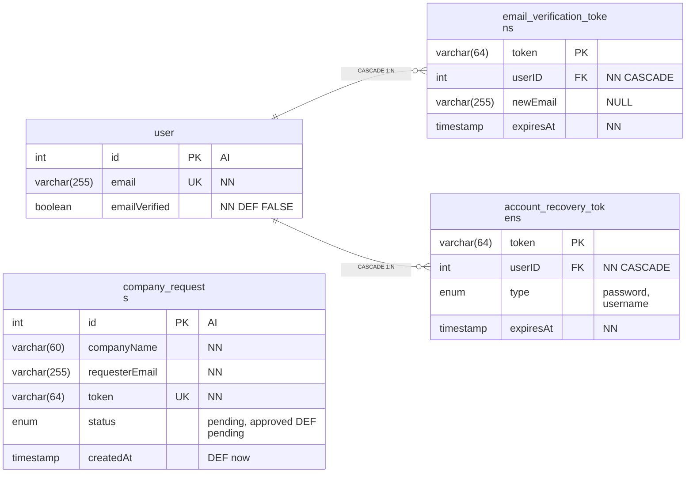

# 3. Database structure

Engine: `InnoDB`.

Table charset: `utf8mb4`. 

---

Below there are 3 ER (Entity-Relationship) diagrams, each one is a seperate section. 

They contain; all tables and relationships in the projeet.

The number in parentheses is the column length. `NN` means NOT NULL, `NULL` means the column may be empty, `AI` means AUTO_INCREMENT, `DEF` means the default, and `CASCADE` means ON DELETE CASCADE. Amounts are `DECIMAL(10,2)`.

## 1. Organizational structure

The `user.profilePhotoFile` refers to a file under `uploads/profiles/{company}/`.

A weekly shift row has a null date. A one-time row has null day.

## 2. Finance

Attachments are uploaded in `uploads/income/{company}/` and `uploads/expense/{company}/`. 

## 3. Accounts, tokens, and company requests

---

---

## Data kept outside MySQL

| Data                           | Where it is stored                                                        |
| ------------------------------ | ------------------------------------------------------------------------- |
| Income and expense attachments | Files under `uploads/income/{company}/` and `uploads/expense/{company}/`. |
| Profile photos                 | Files under `uploads/profiles/{company}/`.                                |
| Rate-limit counters            | `logs/auth_rate_limits.json`                                              |
| Application error log          | `logs/appErrorLog.json`                                                   |
| Logged-in session              | PHP session cookie. There is no sessions table.                           |
| Forecasts                      | Trained model / forecast data aren't saved in the database.               |

